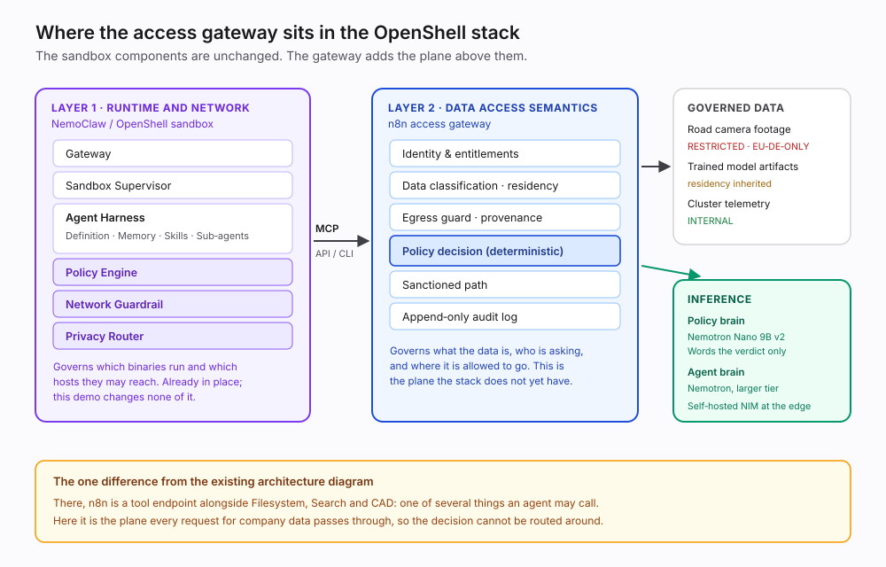
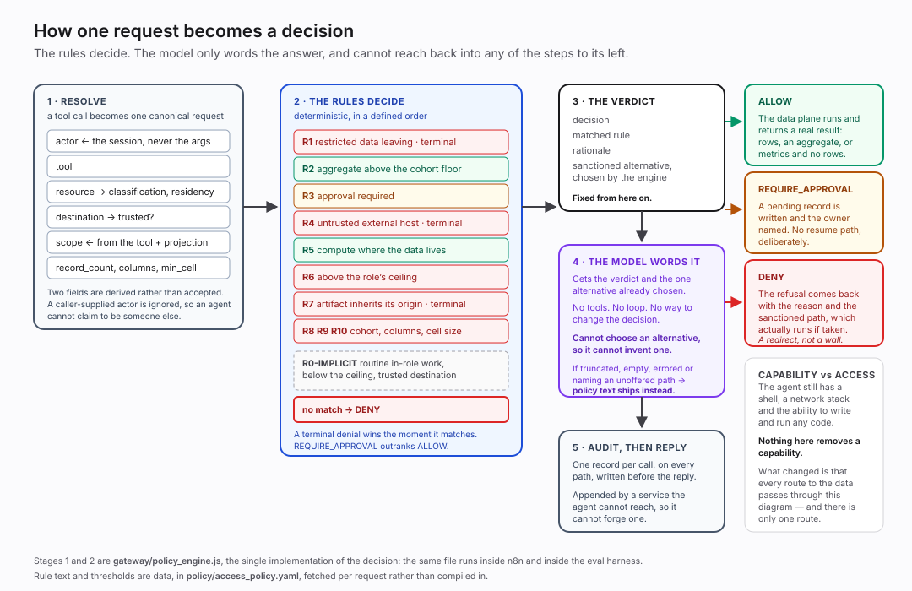
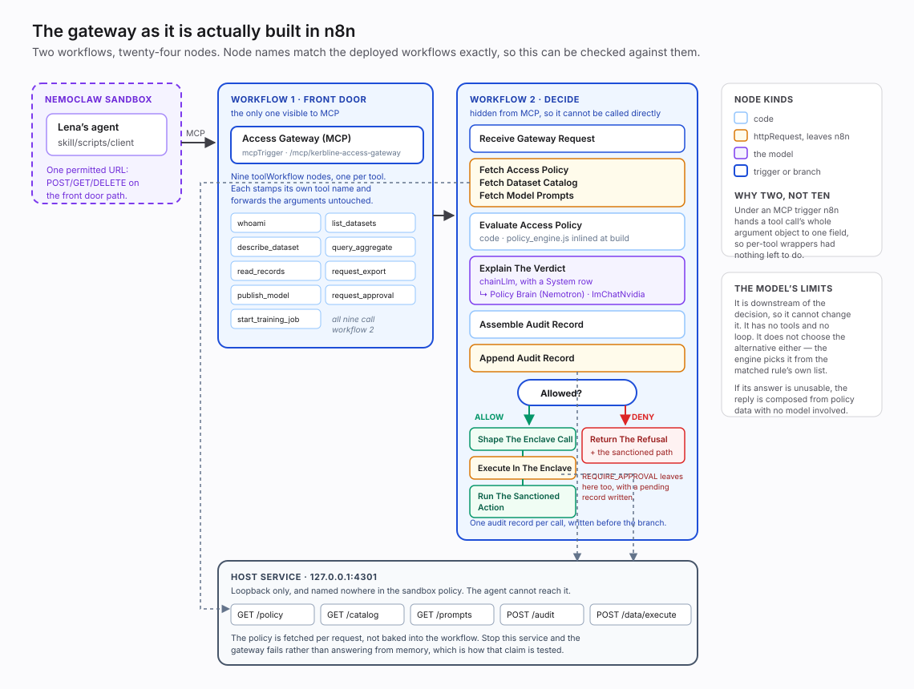

# Architecture

How the pieces fit, which of them decide anything, and where each lives in the repository.

---

## 1. The shape

An agent runs inside a NemoClaw sandbox with all its capabilities intact: shell, code,
network. It has no route to company data except one, and that route is an n8n gateway that
decides every request before serving it.

The claim this architecture makes is narrow. It does not restrict what the agent can do. It
restricts what the agent can reach, and it makes every reach decidable, logged and
explainable.

## 2. Two layers, deliberately independent

| Layer | Governs | Enforced by | Config |
|---|---|---|---|
| 1 | The network: one permitted URL, reachable only through a checking proxy | NemoClaw sandbox | [`policy/sandbox_policy.yaml`](../policy/sandbox_policy.yaml) |
| 2 | Data access: classification, residency, provenance, destination | n8n gateway | [`policy/access_policy.yaml`](../policy/access_policy.yaml) |

**Layer 1 is stronger than the obvious description of it.** It is not a list of forbidden
protocols, and there is no blocklist anywhere in it.

The sandbox has **no direct TCP egress at all**, verified including to the single port its own
policy permits. Everything leaves through an HTTP proxy, and the proxy checks each request
against an allow-list of endpoints, HTTP methods, paths and calling binaries. Exactly one URL is
permitted: `POST`, `GET` and `DELETE` on the gateway front door's path.

`scp` does not fail because a rule names SSH. It fails because SSH needs raw TCP, there is none,
and an HTTP proxy cannot carry it. Nothing had to be enumerated, and nothing has to stay
enumerated as new tools appear in the base image.

And *sharing a port is not sharing access*. n8n serves its own management API on the same 5678
as the front door, so a grant of the bare port would hand over both. The grant names the path,
so it does not: the management endpoint answers `403 denied by L7 policy` from inside the
sandbox.

Two limits. `NO_PROXY` exempts the sandbox's own loopback, so this governs what *leaves* the
sandbox rather than everything happening inside it. And the binary allow-list matches an
executable's **resolved** path, so it cannot distinguish a virtualenv's `python3` from the
system one it symlinks to. It keeps every non-Python binary out. It cannot promise that only
the skill's own interpreter reaches the gateway.

The policy is machine-checked rather than only reasoned about. `policy/prove_single_egress.sh`
runs NVIDIA's own Z3-backed `openshell policy prove` over the file and asserts that the endpoint
set, the paths, the enforcement mode and the finding list are all what the claim requires.

Neither layer trusts the other. Neither is a wrapper around the other.

## 3. Where this attaches to the surrounding stack

The sandbox already contains policy machinery: a policy engine, a network guardrail, a
privacy router. Those govern the runtime and the network, and this project changes none of
them.

What it adds is the plane above: data-access semantics. Whether a given dataset is special
category data, whether a destination is inside the residency boundary, whether a model
artifact inherited a constraint from its training data. That is not something a network
control can answer, because the answer is a property of the data rather than of the traffic.

## 4. What decides, and what only explains

**The rules decide.** [`policy/access_policy.yaml`](../policy/access_policy.yaml) is
evaluated deterministically: resolve the request, walk `evaluation.order`, the first
matching terminal denial wins immediately, `REQUIRE_APPROVAL` outranks `ALLOW`, and no
match means deny. Default-deny is a position, not an oversight. An unanticipated request is
not an authorised one.

**There is one implementation of that, not two.**
[`gateway/policy_engine.js`](../gateway/policy_engine.js) is inlined into the workflow's Code
node at build time and called directly by the eval harness, so the thing being tested and the
thing running in n8n are the same file. Agreement between harness and gateway is therefore not
evidence of anything. What the end-to-end tests prove is everything *around* the decision
rather than the decision itself. That distinction is laid out in [EVALS.md](EVALS.md) §1.

**The model explains.** A local Nemotron receives the verdict, the matched rule's rationale
and the sanctioned alternatives the policy already offers, and produces prose for a human.
It cannot change the verdict.

**The model does not choose the alternative either.** The engine picks it from the matched
rule's own list. This closes off the failure that would otherwise matter most: an
authoritative-sounding suggestion that the policy never sanctioned. A model that cannot
choose cannot invent.

**If the model fails, the answer is still correct.** When a response is truncated, errored,
empty or fails validation, the answer is composed from the rationale and the sanctioned
path summary with no model in the loop. Model text and composed text are never blended.

The consequence is that the guarantees survive an unreliable model. Measured behaviour,
including a case where a model claimed no alternative existed when two did, is in
[EVALS.md](EVALS.md).

## 5. Two model roles

| Role | Job | Constraint |
|---|---|---|
| Policy brain | Word the verdict, describe the chosen alternative | Small, fast, self-hostable. This is the part that has to be sovereign. |
| Agent brain | Drive the agent | Can be large. Decides nothing about access. |

You do not need a frontier model to decide whether restricted data may leave the building.
You need a good small one, which is what fits on hardware you can own. Selection evidence
is in [MODEL_STRATEGY.md](MODEL_STRATEGY.md).

## 6. Request path

Two workflows, twenty-four nodes. The node names in that diagram are the names in the deployed
workflows, so it can be checked against the running instance rather than taken on trust. The
`.ts` files it depicts are the actual source, not a generated rendering of it.

**Why two workflows and not ten.** Nine thin per-tool wrappers existed at one point, to give each
tool a typed per-field schema. That reason does not survive contact with the platform: under an
MCP Server Trigger, n8n hands a tool call's whole argument object to a single field rather than
spreading it across named ones. With the arguments travelling together anyway, the wrappers had
nothing left to do but stamp a tool name, which the front door does with a literal.

1. The agent calls a tool through the skill installed in its sandbox
   ([`skill/scripts/client.js`](../skill/scripts/client.js)).
2. The sandbox network policy permits that skill's interpreter to reach the gateway's front
   door, and nothing else. There is no second permitted destination.
3. The call arrives at the gateway's MCP Server Trigger in n8n directly. No bridge sits in the
   middle, and the host holds nothing to compromise between the two. n8n's own *management* API
   shares that port. It can run any workflow, the decision workflow included, which would mean
   an answer with no decision behind it. Three independent things keep it away. The sandbox
   policy allows only the front door's path on that port, so the management endpoint answers
   `403 denied by L7 policy` before the request leaves the sandbox. The agent holds no token for
   it. And [`n8n/workflows/isolate.sh`](../n8n/workflows/isolate.sh) switches it off entirely as
   the last step of every build. That closes it to everything on the host rather than just to
   this sandbox.
4. The gateway fetches the policy, the dataset catalog and the prompts from the host service on
   `127.0.0.1:4301`, at request time rather than baked in.
5. It resolves identity, classification, residency, provenance and destination into the
   canonical request, then evaluates the policy. Two of those fields are *derived* rather than
   accepted: the actor comes from the session, and the scope comes from the tool and its
   projection. A caller-supplied actor is ignored, which is what stops an agent claiming to be
   someone else.
6. The policy brain words the outcome. The engine has already decided it.
7. The decision is appended to the audit log, whether it allowed or refused.
8. On a refusal, the sanctioned alternative comes back with it. On an allow, the request is
   served by the data plane, also on `4301` and behind the same boundary, so the rows are
   computed in a process the agent cannot reach.

Step 7 happens on both paths. An audit log that only records refusals cannot answer the
question a regulator actually asks, which is what was accessed.

The service listens on loopback and the sandbox policy never mentions it, so the agent can
neither read the policy governing it nor file a record claiming it was allowed something. And
because the policy is fetched per request, taking the service away breaks the gateway rather
than making it answer from memory, which is how the repo proves the policy is not inlined.
See [EVALS.md](EVALS.md) §3.1.

The data plane does not take the `ALLOW` at face value. It re-derives the verdict from the same
`policy_engine.js` the gateway runs, and refuses if the two disagree. That is defence in depth;
the network boundary is still the primary control. One gap remains. `POST /audit` has no verdict
to re-derive, so the audit sink rests on the port being unreachable alone. See
[GATEWAY_CONTRACT.md](GATEWAY_CONTRACT.md) §9.

## 7. Where the decision runs

The decision runs beside the data, so it needs no external network. How operators reach that
box is a separate question, and conflating the two costs you deployments: the governed
decision staying in-country does not require the administrator to. See
[SCENARIO.md](SCENARIO.md) §8.

## 8. Repository map

| Concern | Path |
|---|---|
| The access decision, as data | `policy/access_policy.yaml` |
| The network layer, and the script that proves it | `policy/sandbox_policy.yaml`, `policy/prove_single_egress.sh` |
| The decision engine itself, the one implementation | `gateway/policy_engine.js` |
| Model prompts, generated from the harness so they cannot drift | `gateway/prompts.yaml` |
| Policy, catalog, audit and data-plane service on loopback | `gateway/gateway_services.js` |
| The two gateway workflows, as editable source | `n8n/workflows/gateway-decide.ts`, `gateway-front-door.ts` |
| The build that substitutes into them and deploys | `n8n/workflows/build.js` |
| The isolation invariant, enforced and then verified | `n8n/workflows/isolate.sh` |
| In-sandbox skill (the agent's only exit) | `skill/` |
| Sandbox image and gateway scripts | `sandbox/` |
| n8n bring-up, credentials, rebuild, MCP toggle | `n8n/scripts/` |
| Eval harness, query set, goldens, the three layers | `eval/` |
| Synthetic data generator, verified code tables | `seed/` |
| Audit records, appended at run time | `audit/` (gitignored) |
| Diagrams | `assets/diagrams/` |
| Governance console | `console/` (not yet built) |

## 9. What is not built yet

**The governance console.** `console/` is empty. The audit log it would render is append-only
and already written on every decision, so this is a missing view over existing data rather than
a missing mechanism.

That is the whole list. Everything else described in this document is deployed and exercised;
see [EVALS.md](EVALS.md) for what has been measured and what those measurements do not cover.
